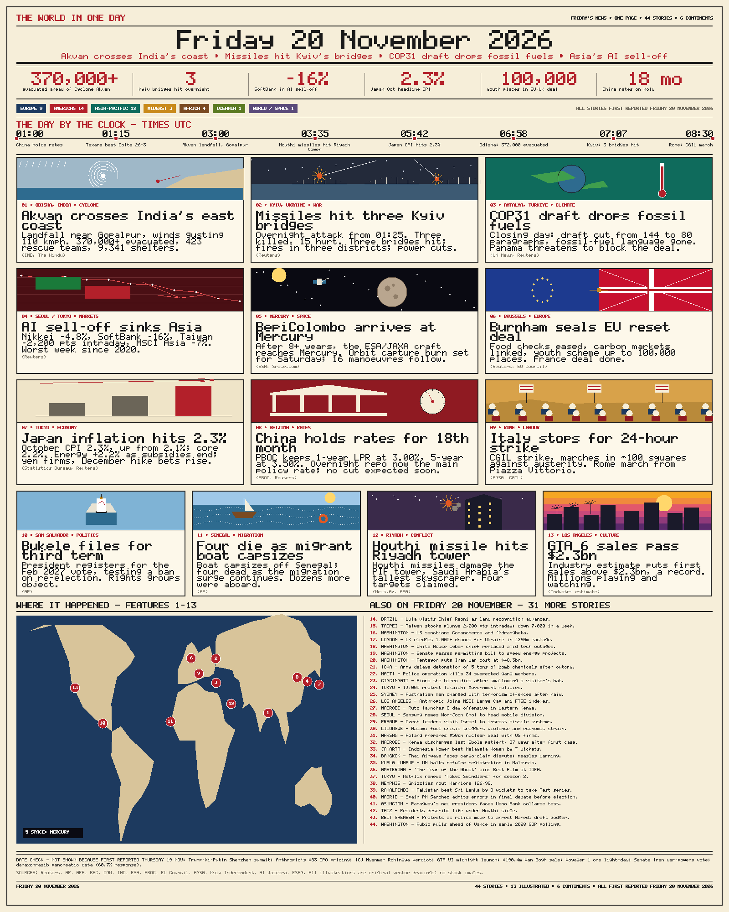

# Friday 20 November 2026 — The World in One Day


One newspaper front page for **Friday 20 November 2026**: **44 real stories**,
all first reported that Friday — 13 illustrated feature stories, a 6-number KPI
strip, region counts across 6 continents, a by-the-clock UTC timeline, a world
map with numbered pins, the full 14–44 story list, and a date-check footer that
names the big Thursday stories this page deliberately leaves out.



## What is on the page

- **13 feature stories**, each with its own original vector illustration drawn
  procedurally (no stock images): Cyclone Akvan's landfall in Odisha, missiles
  hitting three Kyiv bridges, COP31's fossil-fuel-free draft, Asia's AI sell-off,
  BepiColombo arriving at Mercury, the EU–UK reset deal, Japan CPI at 2.3%,
  China holding rates for an 18th month, Italy's 24-hour general strike,
  Bukele filing for a third term, a migrant boat capsizing off Senegal, a Houthi
  missile hitting Riyadh's PIF tower, and GTA 6 sales passing $2.3bn.
- **KPI strip:** 370,000+ evacuated · 3 Kyiv bridges hit · −16% SoftBank ·
  2.3% Japan CPI · 100,000 youth places · 18 months of held China rates.
- **Region counts:** Europe 9 · Americas 14 · Asia-Pacific 12 · Mideast 3 ·
  Africa 4 · Oceania 1 · World / Space 1.
- **The day by the clock (UTC):** 01:00 China holds rates · 01:15 Texans beat
  Colts 26–3 · 03:00 Akvan landfall · 03:35 Riyadh tower hit · 05:42 Japan CPI
  2.3% · 06:58 Odisha evacuations · 07:07 Kyiv bridges hit · 08:30 Rome march.
- **Date check:** the page excludes anything first reported Thursday 19 Nov —
  the Trump–Xi–Putin Shenzhen summit, Anthropic's $83 IPO pricing, the ICJ
  Myanmar verdict, the GTA VI midnight launch, the $190.4m Van Gogh sale,
  Voyager 1's one light-day, the Senate Iran war-powers vote, and the
  daraxonrasib pancreatic data (60.7% response).

## How it is made

`main.ts` (Node stdlib only, no dependencies) renders the page deterministically
and offline: its own framebuffer rasterizer, its own PNG encoder, and its own
5×7 bitmap font. Every illustration is drawn with rect/line/circle/polygon
primitives — no images are fetched or embedded.

```sh
node main.ts            # writes front-page.png (1600×2000)
node main.ts font-test  # writes font-test.png (glyph + pangram sheet)
```

Run it twice and the output is byte-identical (same SHA-256).

Sources: Reuters, AP, AFP, BBC, CNN, IMD, ESA, PBOC, EU Council, ANSA, Kyiv
Independent, Al Jazeera, ESPN.
